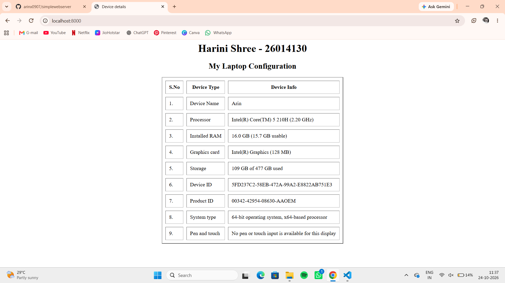
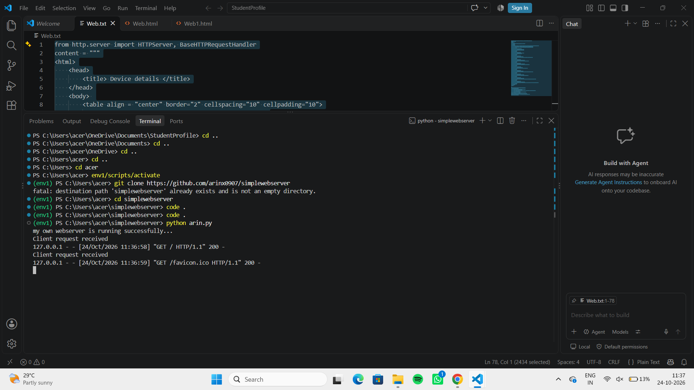

# EX01 Developing a Simple Webserver
## Date:29.09.2026

## AIM:
To develop a simple webserver to serve html pages and display the Windows Specifications of your Laptop.

## DESIGN STEPS:
### Step 1: 
HTML content creation.

### Step 2:
Design of webserver workflow.

### Step 3:
Implementation using Python code.

### Step 4:
Import the necessary modules.

### Step 5:
Define a custom request handler.

### Step 6:
Start an HTTP server on a specific port.

### Step 7:
Run the Python script to serve web pages.

### Step 8:
Serve the HTML pages.

### Step 9:
Start the server script and check for errors.

### Step 10:
Open a browser and navigate to http://127.0.0.1:8000 (or the assigned port).

## PROGRAM:
from http.server import HTTPServer, BaseHTTPRequestHandler
content = """
```
<html>
    <head>
        <title> Device details </title>
    </head>
    <body> 
        <table align = "center" border="2" cellspacing="10" cellpadding="10">
            <h1 align = "center"> Harini Shree - 26014130</h1>
            <h2 align = "center"> My Laptop Configuration</h2>
            <tr>
                <th>S.No</td>
                <th>Device Type</td>
                <th>Device Info</td>
            </tr>
            <tr>
                <td>1.</td>
                <td>Device Name</td>
                <td>Arin</td>
            </tr>
            <tr>
                <td>2.</td>
                <td>Processor</td>
                <td>Intel(R) Core(TM) 5 210H (2.20 GHz)</td>
            </tr>
            <tr>
                <td>3.</td>
                <td>Installed RAM</td>
                <td>16.0 GB (15.7 GB usable)</td>
            </tr>
            <tr>
                <td>4.</td>
                <td>Graphics card</td>
                <td>Intel(R) Graphics (128 MB)</td>
            </tr>
            <tr>
                <td>5.</td>
                <td>Storage</td>
                <td>109 GB of 477 GB used</td>
            </tr>
            <tr>
                <td>6.</td>
                <td>Device ID</td>
                <td>5FD237C2-58EB-472A-99A2-E8822AB751E3</td>
            </tr>
            <tr>
                <td>7.</td>
                <td>Product  ID</td>
                <td>00342-42954-08630-AAOEM</td>
            </tr>
            <tr>
                <td>8.</td>
                <td>System type</td>
                <td>64-bit operating system, x64-based processor</td>
            </tr>
            <tr>
                <td>9.</td>
                <td>Pen and touch</td>
                <td>No pen or touch input is available for this display</td>
            </tr>
        </table>
    </body>
</html>
class myhandler(BaseHTTPRequestHandler):
    def do_GET(self):
        print("Client request received")
        self.send_response(200)
        self.send_header('content-type', 'text/html; charset=utf-8')
        self.end_headers()
        self.wfile.write(content.encode())
server_address = ('',8000)
httpd = HTTPServer(server_address,myhandler)
print("my own webserver is running successfully...")
httpd.serve_forever()

arin.py
```
"""

## OUTPUT:
Webpage


Serverpage


## RESULT:
The program for implementing simple webserver is executed successfully.
